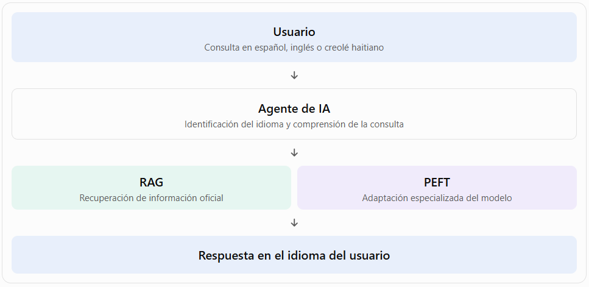

# Decisión de personalización
## 1. El problema
La API debe responder consultas de los usuarios sobre servicios públicos en Santiago, proporcionando información correcta, pertinente y actualizada sobre direcciones, horarios de atención, trámites, requisitos y procedimientos. El principal desafío es que se requiere actualizar las respuestas oportunamente ante cambios normativos u operativos sin incurrir en altos costos ni largos tiempos de espera. Además, se proyecta ampliar la atención a usuarios que realicen consultas en otros idiomas, como inglés y creolé haitiano.

Se evaluaron tres alternativas: **RAG** (_Retrieval-Augmented Generation_), **Fine-Tuning** y **PEFT** (_Parameter-Efficient Fine-Tuning_), considerando los siguientes criterios:

- Frecuencia de actualización de la información.

- Problemas de formato o tono en las respuestas.

- Disponibilidad de un dataset etiquetado y de calidad.

- Presupuesto disponible y velocidad de iteración.

- Necesidad de disponer de múltiples variantes del modelo.
## 2. Resultado del método de decisión

El proceso de selección se realizó mediante una **matriz de decisión basada en criterios booleanos (True/False)**. Se evaluaron las condiciones operativas y técnicas del sistema frente a cada alternativa; cada criterio cumplido (**True**) asignó un puntaje específico a las técnicas compatibles, resultando seleccionada la opción con la mayor puntuación acumulada

En el primer caso de evaluación (API con consultas sólo en español), se considera el atributo **`necesita_multiples_variantes`** como **`False`**, y se obtienen los siguientes puntajes por cada técnica:
```
bash 
caso 2: {'RAG': 5, 'Fine-tuning completo': 0, 'PEFT': 1}
```

Para el segundo caso de evaluación (API con consultas en varios idiomas),  se considera el atributo **`necesita_multiples_variantes`** como **`True`**, obteniéndose los siguientes puntajes:
```
bash 
caso 2: {'RAG': 5, 'Fine-tuning completo': 0, 'PEFT': 3}
```
## 3. Técnica elegida y por qué

Se selecciona **RAG** como técnica principal para la implementación actual de la API. Esta elección se fundamenta en que permite recuperar información desde una base documental verificada antes de generar una respuesta, manteniendo actualizados los conocimientos disponibles para el agente sin necesidad de recolectar nuevos _datasets_, asumir altos costos de cómputo ni reentrenar el modelo cada vez que cambian los requisitos, procedimientos o condiciones de los servicios públicos.
Además, RAG permite separar el conocimiento documental de la capacidad de razonamiento del modelo, facilitando el mantenimiento y la actualización continua de la información.


**Proyección futura: utilización de PEFT**

Se considera **PEFT** como una alternativa para una futura etapa de evolución del proyecto, en la que se contemple ampliar la atención a usuarios que realicen consultas en inglés o creolé haitiano.

Esta adaptación sería complementaria a RAG, que continuaría siendo responsable de recuperar información oficial y actualizada.
La incorporación de PEFT dependerá de las capacidades multilingües del modelo base y de los resultados obtenidos mediante instrucciones y pruebas de prompting.




## 4. Qué se necesita para ejecutarla
Para implementar RAG se necesita construir un _corpus_ documental confiable, compuesto por información oficial de los organismos públicos correspondientes.

Entre las fuentes que se deben considerar se encuentran:

•	**Registro Civil e Identificación:** información sobre cédulas de identidad, pasaportes, requisitos, procedimientos y vigencia de documentos.

•	**ChileAtiende:** información sobre trámites, servicios públicos, requisitos y canales de atención.

• **Sitios oficiales del Gobierno de Chile:** información complementaria sobre procedimientos y servicios públicos.

El trabajo pendiente consiste en:
1.	Identificar y recopilar los documentos oficiales relevantes para el alcance de la API.
2.	Verificar su vigencia, fecha de publicación y organismo responsable.
3.	Limpiar y normalizar los documentos recopilados.
4.	Dividir los documentos en _chunks_ para facilitar su recuperación.
5.	Generar _embeddings_ y almacenarlos en una base de datos vectorial.
6.	Implementar un mecanismo de recuperación que entregue al agente los fragmentos pertinentes para responder cada consulta.
7.	Incorporar mecanismos de actualización del _corpus_ para evitar respuestas basadas en información desactualizada.

**Requerimientos para una futura implementación de PEFT**

En caso de avanzar hacia la adaptación multilingüe del agente, será necesario preparar un conjunto de ejemplos etiquetados que contemple:

•	Consultas frecuentes en inglés y creolé haitiano.

•	Respuestas correctas y contextualizadas en cada idioma.

•	Terminología relacionada con trámites y servicios públicos chilenos.

•	Validación lingüística y revisión de la precisión de las respuestas.

Actualmente, la cantidad de ejemplos etiquetados disponibles para este propósito está pendiente de inventario. Por lo tanto, no es posible determinar todavía cuántos ejemplos adicionales serían necesarios para ejecutar PEFT.
