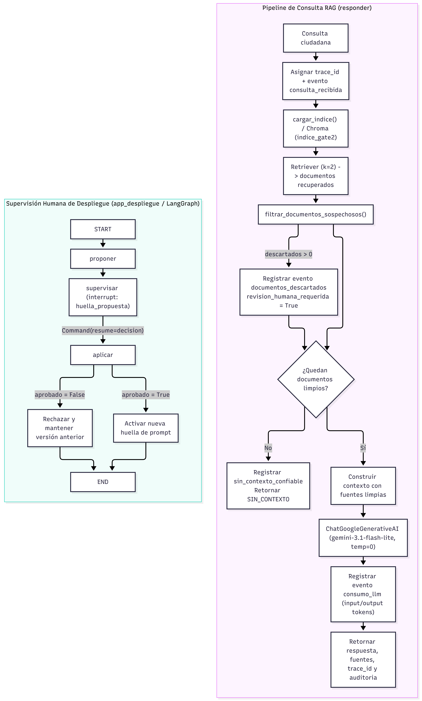

# Gate 2

Servicio de consulta ciudadana mediante **Retrieval-Augmented Generation (RAG)** sobre oficinas y locales de pago de servicios públicos (Registro Civil y ChileAtiende / IPS), con persistencia vectorial, trazabilidad estructurada libre de datos personales (PII), defensa contra inyección de prompts y punto de supervisión humana (*human-in-the-loop*) para despliegue de cambios de prompt.


---

## Estructura del proyecto

```text
repositorio-raiz/
├── ...                      # Otros archivos o carpetas del repositorio
└── gate2-proyecto/
    ├── servicio_rag.py            
    ├── test_gate2.py  
    ├── ensayo_gate2.py            
    ├── indice_gate2/        # Base vectorial Chroma persistida 
    ├── docs/                # Documentación técnica y diagramas
    ├── registros_latencia_costos.jsonl
    ├── requirements.txt           
    ├── .env.example               
    ├── .gitignore                 
    └── README.md                  
```
> **Ubicación del proyecto:** Este servicio se encuentra en `repositorio-raiz/gate2-proyecto/`. Ejecuta los comandos desde esa carpeta.
---

## Diagrama de flujo



---

## Características principales

- **Modelos Gemini (`langchain-google-genai`):**
  - **Embeddings:** `models/gemini-embedding-001`
  - **Generación:** `gemini-3.1-flash-lite` (`temperature=0`)
- **Índice vectorial persistente (`Chroma`):**
  - Almacena los documentos en el directorio local `indice_gate2/` (`collection_name="gate2"`).
  - Reutiliza el índice existente entre ejecuciones (`indice_reutilizado`) y solo indexa `CORPUS` si la colección está vacía (`indice_creado`).
- **Defensa contra inyección de prompts:**
  - `detectar_inyeccion()` y `filtrar_documentos_sospechosos()` inspeccionan cada documento recuperado antes de armar el contexto del LLM.
  - Descarta documentos sospechosos, registra el evento `documentos_descartados` con `revision_humana_requerida=True` y responde solo con fuentes limpias (o devuelve `SIN_CONTEXTO` si no quedan documentos confiables).
- **Trazabilidad y privacidad en logs:**
  - Genera un `trace_id` único (`trace-<hex>`) por consulta.
  - `evento(...)` emite logs JSON solo con longitudes y conteos (`pregunta_len`, `n`, `input_tokens`, `output_tokens`), sin registrar texto libre ni datos personales.
- **Supervisión humana con `LangGraph` (`interrupt` + `Command`):**
  - Grafo de estados `proponer -> supervisar -> aplicar` respaldado por `InMemorySaver`.
  - Pausa el despliegue de una nueva huella (`huella_nueva`) hasta recibir `Command(resume=True)` o `Command(resume=False)` en un `thread_id` dado.

---

## Requisitos e instalación

### Requisitos previos
- **Python 3.10** o superior.
- Clave de API de Gemini (**`GEMINI_API_KEY`** o **`GOOGLE_API_KEY`**).

### Pasos de configuración

1. **Ubícate en la carpeta del proyecto dentro del repositorio:**
   ```bash
   cd repositorio-raiz/gate2-proyecto
   ```

2. **Crea y activa un entorno virtual (recomendado):**
   ```bash
   # En Windows (PowerShell):
   python -m venv venv
   .\venv\Scripts\Activate.ps1

   # En macOS / Linux:
   python3 -m venv venv
   source venv/bin/activate
   ```

3. **Instala las dependencias:**
   ```bash
   pip install -r requirements.txt
   ```
   *(Asegúrate de que `requirements.txt` incluya `langchain-core`, `langchain-chroma`, `langchain-google-genai` y `langgraph`, además de `pytest` si correrás las pruebas).*

4. **Configura las variables de entorno:**
   ```bash
   # En Windows (PowerShell):
   Copy-Item .env.example .env

   # En macOS / Linux:
   cp .env.example .env
   ```
   Luego edita `.env` y asigna tu clave:
   ```env
   GEMINI_API_KEY=tu_api_key_aqui
   ```
   *(También puedes exportarla directamente en tu sesión de terminal con `export GEMINI_API_KEY="..."` en Linux/macOS o `$env:GEMINI_API_KEY="..."` en PowerShell).*

---

## Ejecución y pruebas

### Ejecutar el servicio (`main()`)
Desde `repositorio-raiz/gate2-proyecto/`:

```bash
python servicio_rag.py
```

El script ejecuta cuatro bloques principales:
1. **Carga o creación del índice:** Inicializa `Chroma` en `indice_gate2/`.
2. **Consultas RAG de validación:** Evalúa 4 preguntas sobre servicios públicos en las comunas de Ñuñoa y de Providencia, y una consulta fuera de cobertura (comuna de Maipú, esperando `SIN_CONTEXTO`), verificando con `assert` que las respuestas con información citen fuentes.
3. **Prueba controlada de inyección de prompts:** Crea la colección temporal `prueba_inyeccion_tmp` con un documento limpio y uno malicioso, comprueba que se descarte el malicioso, active `revision_humana_requerida: true`, use solo la fuente oficial y borre la colección temporal.
4. **Simulación de supervisión humana (`app_despliegue`):** Prueba el ciclo de pausa (`__interrupt__`) y reanudación en dos hilos distintos: aprobación (`Command(resume=True)` en `despliegue-stgo-aprobar-1`) y rechazo (`Command(resume=False)` en `despliegue-stgo-rechazar-1`).

### Ejecutar pruebas automatizadas
```bash
python -m pytest .\test_gate2.py -v
```

---

## Estructura del código

| Componente | Descripción |
| :--- | :--- |
| `evento(...)` | Emite logs JSON con `trace_id` registrando solo métricas y conteos, sin contenido libre. |
| `CORPUS` / `cargar_indice()` | Documentos oficiales de oficinas y gestión persistente del índice en `indice_gate2/`. |
| `PATRONES_SOSPECHOSOS` / `filtrar_documentos_sospechosos()` | Filtro determinista para separar documentos limpios de posibles inyecciones de prompt. |
| `responder()` | Orquesta recuperación (`k=2`), filtrado, prompt estricto, invocación al LLM y registro de tokens. |
| `EstadoDespliegue` / `app_despliegue` | Grafo de estados en `LangGraph` (`proponer -> supervisar -> aplicar`) con `interrupt()` y `Command`. |

---

## Notas operativas

- **Reindexación:** Si modificas `CORPUS` o cambias el modelo de embeddings (`models/gemini-embedding-001`), elimina la carpeta `indice_gate2/` antes de volver a ejecutar para regenerar los vectores.
- **Checkpoints en memoria:** `InMemorySaver()` es adecuado para desarrollo y pruebas; en producción conviene usar un checkpointer persistente.


## Registro de ensayo funcional
- **Fecha:** 2026-11-26
- **Encontrado:** faltaba actualizar archivo **README** e implementar el archivo **test-gate2.py**.
- **Corregido:** se actualizan archivos **README** y **test-gate2.py**, tras lo cual se actualiza repositorio.
- **Resultado tras la corrección:** todas las validaciones solicitadas generan el resultado esperado.